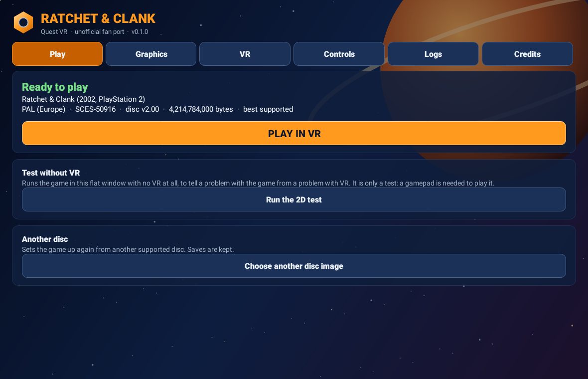

<p align="center"></p>

<h1 align="center">Ratchet & Clank — Quest VR</h1>

<p align="center">An unofficial port of Ratchet & Clank (2002, PlayStation 2) to standalone VR on Meta Quest, bringing <a href="https://github.com/npiriou/Rerac-vr"><b>npiriou's Rerac-vr</b></a> to the headset on OpenRAC's native port. You supply your own disc image; no game files are included.</p>

## Built on Rerac-vr

**This project is a Quest port of [Rerac-vr](https://github.com/npiriou/Rerac-vr) by [npiriou](https://github.com/npiriou), the PC VR mod for Ratchet & Clank, and his work is its main base.** Rerac-vr worked out how Ratchet & Clank should play in VR; this port carries that design to a standalone headset. From Rerac-vr come:

- **The VR design:** first person through Ratchet's eyes, Ratchet facing and shooting where your hand points, the weapon held in your hand, and quick select by reaching for a weapon.
- **The controls:** the Touch controller layout, button for button, and the comfort choices (eye height, snap turning, recentring).
- **The game knowledge:** his notes on the hero's attached items (which mobys are Clank, his pack and the item in the hand) are how this port hides Ratchet's body and Clank in first person and keeps the weapon.
- **The features:** real wrench swings and throws, thrown bombs, two-handed weapons and Akimbo, ledge grabbing, swimming strokes, bolt cranks, plugged-in gadgets, turrets, Clank's and Giant Clank's fists, the hoverboard, the menu and the vendors in the world, the haptics and more: each is Rerac-vr's, rebuilt here; [docs/STATUS.md](docs/STATUS.md) tracks them one by one.

Rerac-vr runs on [ReRAC](https://github.com/re-rac/rerac), a Rust rewrite of the game that a headset's processor cannot yet carry at frame rate, so this port runs [OpenRAC](https://github.com/OpenRAC/OpenRAC)'s recompiled game instead and rebuilds Rerac-vr's features on it in its own VR mod (`vr/`). **If you play on PC, play [Rerac-vr](https://github.com/npiriou/Rerac-vr)**: it is the complete experience, and the one this port follows.

**Latest:** [0.1.4](https://github.com/moistman42069/RatchetAndClank-Quest-VR/releases/latest), a public test build of the whole Rerac-vr port. **We need your logs:** see [Support and project](#support-and-project). The launcher updates itself from the Releases page.

> **Experimental / WIP:** the game is OpenRAC's native port, not an emulator, with a VR mod of its own. Rerac-vr's features are in and have run on PC with the PAL disc and a simulated headset. Walking and the launcher's update are confirmed on a real Quest, but most of the game has yet to be played on one, and the NTSC-U disc has never been run at all. Expect bugs. [docs/STATUS.md](docs/STATUS.md) lists every feature and how far it has been tested; [docs/HEADSET_CHECKLIST.md](docs/HEADSET_CHECKLIST.md) what to try on the headset.

## Downloads

| Platform | Download |
| --- | --- |
| Meta Quest 3 / 3S — standalone VR | `RatchetQuestVR-<version>.apk` on the [latest release](https://github.com/moistman42069/RatchetAndClank-Quest-VR/releases/latest) |

Quest 2 and Quest Pro may run it, slower; they are untested. The APK holds no game data.

## What you need

- A Quest 3 or 3S in Developer Mode, for sideloading.
- About 6 GB free on the headset.
- **Your own `.iso` of exactly one of these discs:**

| Disc | Serial | Version | Size in bytes | SHA-1 |
| --- | --- | --- | --- | --- |
| PAL (Europe), best supported | SCES-50916 | v2.00 | 4,214,784,000 | `ef304c641c7cd426ba492707dda5974679befbc0` |
| NTSC-U (North America) | SCUS-97199 | v1.00 | 4,214,095,872 | `aee9275384f739c9b24cd5de6f7e200292db7b01` |

Greatest Hits, Platinum, other regions and the sequels are not supported. The launcher checks the disc and says exactly why one is refused.

## Installing and updating

- **Install:** with Developer Mode on, get the APK onto the headset and install it: download it in the Quest's browser (or email it to yourself and download it there) and open it from the Files app, or sideload it with SideQuest or `adb install -r`. Then open **Ratchet & Clank Quest VR** from your Library's **Unknown Sources**.
- **Set up:** put your `.iso` where the headset's file picker can see it (the Download folder), and choose it in the launcher. The first set-up copies the disc and prepares the levels: up to half an hour, once. Keep the headset on charge.
- **Play:** press **PLAY IN VR**. **Play in 2D** puts the game on a big flat screen in the headset, played with the Touch controllers as a PlayStation pad: no gamepad needed, and it tells a game problem from a VR problem.
- **Updates:** the launcher's Play tab checks this repository's releases (automatically every six hours, or with **Check now**; switch it off there). An update is downloaded, checked against GitHub's SHA-256, its size, the app's package, a newer version and the app's signing key, then handed to Android's installer, which asks you. Your set-up, saves and settings are kept. Installing a new APK over the old one by hand keeps them too; **do not uninstall or clear the app's data**.
- **Level updates:** when a new version reads its levels in a newer form, the Play tab offers **Update the levels**, made again from the disc already on the headset.

## Highlights

- **Native, not emulated:** OpenRAC's recompiled game draws every object of a level whatever the game culled, so turning your head never pops the world in.
- **First person** through Ratchet's eyes, his body, Clank and the pack hidden, the weapon in your right hand; or **third person** from the game's camera, the horizon level and the stick walking where you look. **VR Options** switches between them at any time, in the game or on the title.
- **Smooth turning by default**, snap turning (30–90°) as an option; walking towards where you look; Ratchet faces where your right hand points.
- **Cutscenes in VR:** the game's in-engine scenes in 3D around you from its camera, your head free to look round; or, in the VR tab, **on a screen** in the game's own framing. Movies play on the screen.
- **Menus in the world:** the title's own 3D scene around you and the pause menu standing in the level, with the menus' 3D models in stereo; point and pull the trigger. The vendors are on their own monitors, and you can walk while shopping.
- **Vibration** on shots and hits; quick select by reaching towards a weapon.
- **Graphics:** presets, 72–120 Hz (back to 72 Hz when a higher rate is not held), eye resolution, MSAA, texture filtering, draw distances.
- **Everything can be switched** in the launcher and in **VR Options** (Options, then VR Options: helmet, boots, camera flip, direction, player body, Akimbo, play position, view).
- **Launcher:** disc requirements and checks, set-up progress, settings, controls, logs, credits, updates.

## Controls

| Control | Action |
| --- | --- |
| Left stick | Walk, towards where you look |
| Right stick | Turn (smooth by default; snap in the VR tab). In third person, the game's camera |
| A | Jump; twice for a double jump |
| B | Hover and strafe with Clank's packs, Hydro-Pack boost |
| X | Map |
| Y | Pause; skips a cutscene |
| Right trigger | Fire; with an empty hand, takes your last gun or glove back out |
| Right grip | Takes the wrench out; swing your hand for real to hit. Let go slowly to put it away and leave your hand empty, which is how to put a gun or a glove down |
| Left grip or trigger | Crouch, and the packs (with A: long and high jumps, flips). Not while the left hand holds a ledge or a big weapon's barrel |
| Right stick click | Talk; hold for quick select, move your right hand towards a weapon, let go |
| Left stick click | With Akimbo on: the left hand's own quick select |
| Left menu button | Recentre (the headset's own recentre too) |

In menus point with your right hand and pull the trigger or press A; the sticks move a cursor only where there is nothing to point at, or with the right controller off. B goes back, and the left grip and trigger turn the pages. The layout is Rerac-vr's, from its source; the whole list is in the launcher's Controls tab. In **2D mode** the controllers are a PlayStation pad: A Cross, B Circle, X Square, Y Triangle, triggers L1 and R1, grips L2 and R2, the left menu button Start, the left stick click Select.

## Support and project

**Logs are what this project needs most.** Please report both failures and successful runs: headset and its OS version, the app's version, your disc (PAL or NTSC-U), the planet, any settings you changed, what you did, and the log of that run. After playing, **open the launcher again**: that is what writes the run's log.

| Where | Each run's log |
| --- | --- |
| Quest | **Download/RatchetQuestVR**: the newest file is the last run (or set-up), with the game's own log, why VR stopped if it did, and the app's Android log. The launcher's **Logs** tab shows a summary of the last run. |

Report with the [headset report form](https://github.com/moistman42069/RatchetAndClank-Quest-VR/issues/new?template=headset-report.yml) in GitHub Issues, attaching the `.txt` file, or DM **@MeWhenINameMyself** on Discord. Please do not report this port's bugs to Rerac-vr, ReRAC or OpenRAC. [docs/HEADSET_CHECKLIST.md](docs/HEADSET_CHECKLIST.md) lists what most needs trying.

This is an unofficial community project, not affiliated with or endorsed by Sony Interactive Entertainment or Insomniac Games. No game files are distributed. See [credits](CREDITS.md) and [third-party notices](THIRD_PARTY_NOTICES.txt).

## How it fits together

| Part | Where | What it is |
| --- | --- | --- |
| The game | `third_party/OpenRAC` | [OpenRAC](https://github.com/OpenRAC/OpenRAC) 0.10.1 as a submodule (`293cb5cc`), with the Quest's changes to its frame path in [`patches/`](patches) |
| The VR mod | `vr/` | A native OpenRAC mod: OpenXR on the Quest, the head and hands into the game's views, Touch controllers into its pad |
| The launcher | `android/` | The APK: disc import and set-up, settings, controls, logs, credits, updates |
| The build | `tools/build_quest.py` | Everything into one APK; `tools/build_pc.py` for the PC test |
| Status | [`docs/STATUS.md`](docs/STATUS.md) | Every feature, and the strongest test each has had |

Why OpenRAC and not ReRAC, which the PC VR mod is built on: Rerac-vr's own measurements (51–59 fps near spawn, 14–25 under Blaster fire on a Ryzen 5 5600 and RTX 3090) rule it out on a headset's CPU; Rerac-vr's design is ported into `vr/` instead. More in [docs/STATUS.md](docs/STATUS.md).

## Building

On Windows with Git Bash (the tested set-up), in a folder without spaces:

```sh
git clone --recursive https://github.com/moistman42069/RatchetAndClank-Quest-VR.git C:/RACQuest/RatchetQuestVR
cd C:/RACQuest/RatchetQuestVR
bash tools/setup_toolchain.sh        # JDK 17, Android SDK 34, NDK 27.2, Rust, under C:\RACQuest\toolchain
source env.sh
python tools/build_quest.py --release
```

It needs Python 3.13 or later, CMake 3.24 or later and Ninja on the PATH. The build stops unless OpenRAC is at the pinned commit with `patches/` applied (it applies them to a clean checkout), runs the launcher's tests, and opens the finished APK to check it. A release must be signed with the project's key (see [docs/RELEASING.md](docs/RELEASING.md)); without it the APK is signed with your debug key, and the launcher's updater will not install over it.

## Licence

This project is free software under the GNU General Public License, version 3 or (at your option) any later version (`GPL-3.0-or-later`), without any warranty; the full text is in [LICENSE](LICENSE).

- **Why:** the game it runs is OpenRAC (GPL-3.0-or-later), and the walking and facing hooks come from OpenRAC's rac1-mods (GPL-3.0-or-later).
- **Source:** each release's source is its tag: this repository, OpenRAC at the submodule's commit, and `patches/`.
- **Other parts:** third-party code keeps its own licence, listed in [THIRD_PARTY_NOTICES.txt](THIRD_PARTY_NOTICES.txt); Rerac-vr's design is used under its ISC License.
- **Ratchet & Clank is not covered:** the licence covers this project's and its upstreams' work, and gives no rights in Ratchet & Clank, a trademark of Sony Interactive Entertainment, or anything else Sony or Insomniac Games own.
